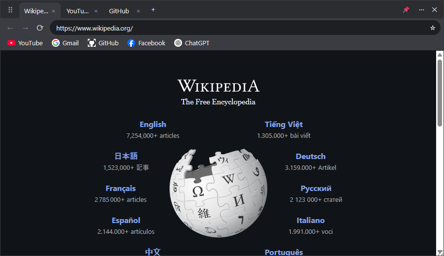

# Dock Web

A small browser window that always floats on top of the screen: watch YouTube, chat, or look things up while working in another app, without switching back and forth.



> The app's interface is in Vietnamese.

## Download

Download **`Dock-Web-Setup-x.y.z.exe`** from the [Releases](https://github.com/NgVietKhoa/Dock-Web/releases/latest) page, open it and follow the installer. Windows 10/11 (64-bit) only.

> The installer is not code-signed, so Windows may show *"Windows protected your PC"*. Click **More info** → **Run anyway** to continue.

To update, just install the new version over the old one; tabs, bookmarks, history and signed-in accounts are kept.

## Features

**Floating window**
- Always on top, even over games and fullscreen apps (toggle with the 📌 button).
- Drag an empty spot on the tab bar to move the window; drag an edge or corner to resize. Position and size are remembered.
- Quickly snap to the left / right / top / bottom edge of the screen and adjust opacity (⋯ menu).
- **Click-through:** the window fades and every click passes to the app underneath — handy for watching a video while working.
- The ✕ button only hides the window to the system tray; quit for real via the ⋯ menu or by right-clicking the tray icon.

**Browses like Chrome**
- Multiple tabs: drag to reorder, middle-click to close, `Ctrl+Shift+T` to reopen the last closed tab. Tabs are restored when the app reopens (only the active tab is loaded, to keep things light).
- The address bar accepts both URLs and search terms, with suggestions from history and Google search suggestions.
- Bookmarks bar: ☆ to save a page, right-click to rename or delete.
- Per-site zoom (`Ctrl + mouse wheel`), find in page (`Ctrl+F`), mute individual tabs (🔊).
- Stays signed in between launches. "Sign in with Google/Facebook" popups open in their own window.
- Drag a link, file or URL from another browser into the window to open it in a new tab.

## Keyboard shortcuts

| Keys | Action |
|---|---|
| `Ctrl+Shift+Space` | Hide / show the window (works from any app) |
| `Ctrl+Alt+Space` | Toggle click-through (works from any app) |
| `Ctrl+T` / `Ctrl+W` | New tab / close tab |
| `Ctrl+Shift+T` | Reopen the last closed tab |
| `Ctrl+Tab`, `Ctrl+Shift+Tab`, `Ctrl+1…9` | Switch tabs (`Ctrl+9` = last tab) |
| `Ctrl+L`, `Alt+D`, `F6` | Focus the address bar |
| `F5`, `Ctrl+R` / `Ctrl+Shift+R` | Reload / reload bypassing the cache |
| `Alt+←` / `Alt+→` | Back / forward |
| `Ctrl+D` | Add / remove bookmark |
| `Ctrl+F` | Find in page |
| `Ctrl +` / `Ctrl -` / `Ctrl+0` | Zoom in / zoom out / reset to 100% |

If `Ctrl+Shift+Space` or `Ctrl+Alt+Space` is already taken by another app (Unikey, screenshot tools…), Dock Web shows a notice in the system tray on launch; use the tray icon instead.

## Notes

- **Google sign-in:** Google sometimes blocks sign-in inside apps that embed a browser ("This browser or app may not be secure"). Dock Web works around this in most cases; if it still fails, try again in a few minutes or turn off your VPN.
- **Data** (tabs, bookmarks, history, login cookies) lives in `%APPDATA%\dock-web`. Delete this folder to reset the app.
- While you type in the address bar, the text is sent to Google to fetch search suggestions (same as Chrome).

## Running from source

Requires [Node.js](https://nodejs.org/) 20 or later.

```bash
git clone https://github.com/NgVietKhoa/Dock-Web.git
cd Dock-Web
npm install
npm start          # run in development
npm run dist       # build the installer into dist/
```

The source consists of 3 main files, built with [Electron](https://www.electronjs.org/):

| File | Role |
|---|---|
| `main.js` | Window, system tray, global shortcuts, Google sign-in handling |
| `preload.js` | Secure bridge between the UI and `main.js` |
| `index.html` | The entire UI: tabs, address bar, bookmarks, menus |

Releasing a new version: bump `version` in `package.json`, run `npm run dist`, then upload `dist/Dock-Web-Setup-<version>.exe` to a new GitHub Release.
